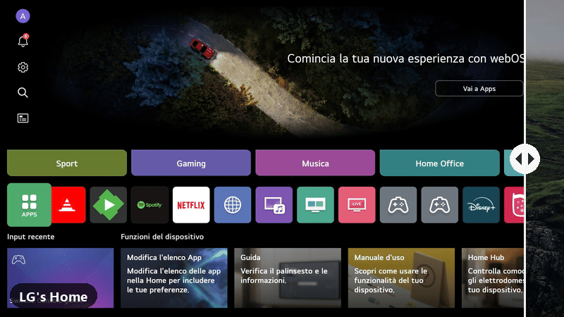
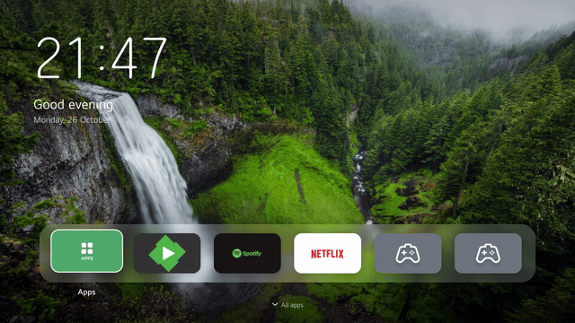
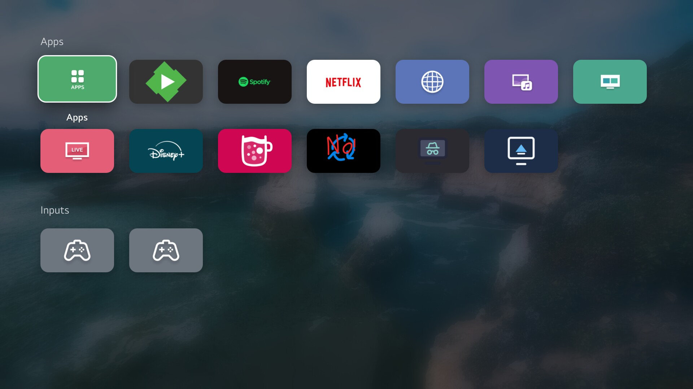

# TV Home

A calm, clean **Home screen for rooted LG TVs with webOS 10** (LG's
"webOS 25"): your photos in the background, the clock, and your apps in a
dock. No banners, no ads, no recommendations.

▶ [Drag the divider yourself](https://lg-home-slideshow.github.io/lg-webos-tv-home/)

- **Your photos** as the background, cross-fading and slowly drifting
- **Clock, greeting and date**, with your name if you like
- **A dock** for your favourite apps and inputs (HDMI), in your order
- **All apps** one step down: apps, inputs, and the ones you hid
- **Hold OK** on any app to move it, add it to the dock, hide it or uninstall it
- **Photos only**: one step up, and the dock and clock make way
- App icons that bring their own background (Spotify, Emby...) fill their tile
- Works with the arrow keys and with the Magic Remote's pointer

Nothing on the TV's system is changed: TV Home is laid over LG's Home in
memory at every start. If TV Home ever stops answering, the TV gets LG's Home
back by itself; uninstalling, or a start without the boot hook, brings back
LG's Home exactly as it was.

## What you need

- An LG TV with **webOS 10**, rooted, with the
  [Homebrew Channel](https://github.com/webosbrew/webos-homebrew-channel)
  installed and **SSH enabled** in its settings
- A Windows PC on the same network (Windows 10 or 11; OpenSSH is built in)
- Optional: **ffmpeg** (`winget install Gyan.FFmpeg.Essentials`) to prepare
  photos in any format (HEIC, WebP...) and at the TV's size. Without it, JPG
  and PNG photos are sent as they are.
- The TV's root password (default `alpine`), asked once per run. The setup
  offers to create an SSH key on the first run; after that no password is
  needed, and after the TV's next restart only that key can log in.

## Download

Get the latest ZIP from [Releases](https://github.com/lg-home-slideshow/lg-webos-tv-home/releases)
(or **Code > Download ZIP** above) and unpack it anywhere on your PC.

## How to use it

1. Put your photos in the `Fotos` folder. They are shown in file-name order,
   starting at a random one.
2. Double-click **`Start.cmd`** and choose **1 Install or update**.
3. Answer the questions: the TV's IP address, the SSH key, the name for the
   greeting, the language of the date, the clock, and seconds per photo.
4. The setup checks the TV, prepares the photos, copies everything over and
   makes TV Home the Home screen. Your answers are remembered for the next run.

To change only the photos later, choose **2 Change photos**.

## On the TV

| Key | What it does |
|---|---|
| ◀ ▶ | move along the dock |
| **OK** | open the app or input |
| **hold OK** | options: move, add to / remove from the dock, hide, uninstall |
| ▼ | All apps (▲ or Back to return) |
| ▲ | photos only (▶ next photo; ▼, OK or Back to return) |

With the Magic Remote: point at a tile and click to open it; press and hold
for its options.

To move an app in the dock: hold OK, choose **Move**, then ◀ ▶ and OK.
Hidden apps wait at the end of All apps; hold OK on one to show it again.

## Menu

| | |
|---|---|
| 1 Install or update | everything described above; your dock order stays |
| 2 Change photos | new photos only |
| 3 Back up | saves TV Home's files, settings, dock and photos from the TV to a `tv-backup-*.tar.gz` here |
| 4 Uninstall | gives LG's Home back and removes TV Home from the TV |

## Good to know

- After switching the TV on from off, LG's Home shows for about two minutes
  until TV Home takes over (the TV's app manager is ready only then). Waking
  the TV from standby shows TV Home at once.
- Apps from the LG Content Store and the Homebrew Channel can be
  uninstalled; LG's own apps and the inputs can only be hidden.
- Works together with
  [LG Home Slideshow](https://github.com/lg-home-slideshow/lg-home-slideshow):
  apps hidden there are hidden here too, and its slideshow is back whenever
  LG's Home is.
- If [UxAir](https://github.com/depius/uxair-webos) (an AirPlay receiver) is
  installed, TV Home starts it at each start with the request to stay in the
  background, so iPhones and iPads always find the TV. This needs a UxAir
  version that can run in the background; others open in front instead.
- Tested on webOS 10.3.1 (LG OLED C4). Logs on the TV:
  `/home/root/tv-home/tv-home.log` and `server.log`.
- By hand on the TV (over SSH): `sh /home/root/tv-home/tv-home.sh status`,
  `give` (LG's Home back until the next start) and `take` (TV Home again).
- `settings.json` holds your TV's address and the name in the greeting. Do not
  pass it on.

## How it works

- **`tv/tv-home.sh`** (on the TV, from the Homebrew Channel's startup folder
  at every start) mounts TV Home's app folder over LG's Home app under LG's
  app id, has the TV's app manager re-read it, and stops LG's Home: the Home
  button, Back out of an app and waking up then open TV Home. A watchdog gives
  LG's Home back if TV Home stops answering. Everything is in memory; a
  restart undoes it.
- **`tv/app-qml/`** is TV Home itself, a QML app drawn by the TV's graphics
  chip (Qt Quick).
- **`tv/server.js`** runs with the TV's own Node.js on `127.0.0.1` only: it
  lists the apps and inputs from the app manager, serves their icons and your
  photos, launches apps and keeps the dock order (`state.json`).
- **`Install-TVHome.ps1`** (Windows) asks the questions, prepares the photos
  and sends everything with **`install.sh`** over one SSH connection;
  `install.sh` checks the TV, installs, links the boot hook
  (`/var/lib/webosbrew/init.d/70-tv-home`) and makes TV Home the Home.
- **`tv/ui/`** is an earlier version for the TV's web browser engine (slower
  on the TV), kept for trying the design on a PC: `node tv/server.js --demo`,
  then open http://127.0.0.1:8650/ (Enter = OK, Esc = Back, hold Enter =
  options; a few JPGs in `tv/photos` give it a background).

## Credits

- Replacing the Home app on webOS 10 the way
  [Glasshouse](https://github.com/rorygallagher2024/glasshouse) found out.
- Design inspired by [PearWebOS](https://github.com/Arnedeklerk/PearWebOS).
- Photos in the screenshots from [Unsplash](https://unsplash.com): Alexey
  Topolyanskiy, Andrew Ridley, Andrew Coelho and Joseph Barrientos.

## License

[MIT](LICENSE)

## Disclaimer

Use at your own risk. It runs as root on your TV. It does not write to the
TV's system partitions, but no responsibility is taken for any damage.
Not affiliated with or endorsed by LG Electronics.
